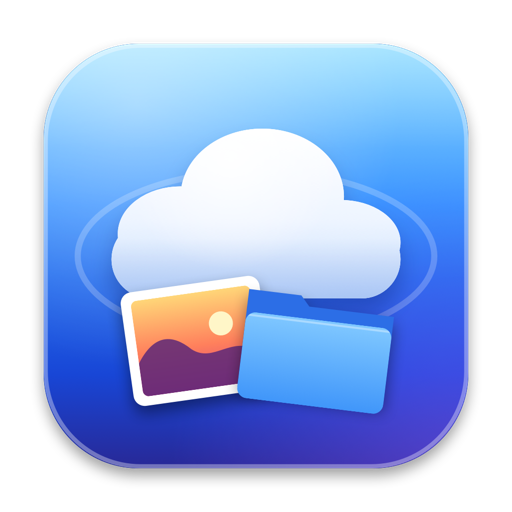
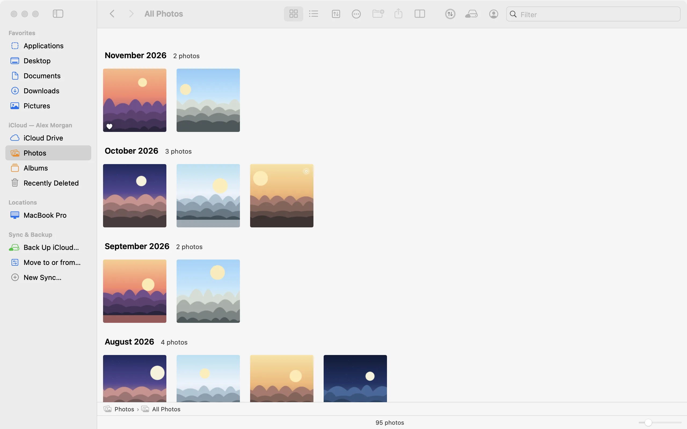

<p align="center"></p>

<h1 align="center">Cirrus</h1>

<p align="center"><b>Your iCloud, in a real Finder.</b><br>
A native app for browsing, moving, syncing and backing up iCloud Drive and iCloud Photos — even on a computer that isn't signed in to iCloud.</p>

<p align="center"><a href="https://zephyrsai.github.io/Cirrus/">Website</a> · <a href="https://github.com/ZephyrSai/Cirrus/releases/latest">Download</a> · <a href="BUILDING.md">Build it yourself</a></p>



## What it does

- **Finder-style browsing.** Icon and list views, tabs, two panes side by side, Quick Look, Get Info, a path bar, sorting and type-to-select.
- **Drag anything anywhere.** Move files between iCloud Drive, iCloud Photos, your disks, connected cameras and phones, and Finder.
- **Photos, properly.** The library is grouped by month, with albums, Live Photos, favorites and Recently Deleted. Export originals with their capture dates.
- **Managed transfers.** A real queue with speed and time left, size checks before anything starts, automatic retries, and no idle sleep while files move.
- **Sync jobs.** Copy, mirror or two-way sync a folder with iCloud Drive: by hand, on a schedule, or when a drive is plugged in. You always see a preview first.
- **Back Up iCloud.** Checks space, then downloads everything as ordinary files and folders on a drive you choose. Photos are sorted into `YYYY/MM` folders with their Live Photo videos, edits and RAW files. Later runs fetch only what's new.
- **iCloud ⇄ Google.** Move iCloud Drive and Photos to Google Drive and Google Photos, or bring Google Drive and a Google Takeout export of your photos into iCloud. Albums and favorites come along. Runs are resumable and incremental, and nothing is ever deleted.
- **Two ways in.** Uses the Mac's own iCloud when it's signed in. Otherwise, sign in to one or more Apple IDs the way iCloud.com does, including two-factor and Advanced Data Protection approval.

## Privacy and safety

- **Talks only to Apple.** No servers, analytics or accounts of its own.
- **Password.** Your Apple ID password is sent only to Apple, using SRP (it never leaves in plain form). Cirrus keeps it only if you ask: in this Mac's Keychain, never synced, and unlocked by Touch ID or your Mac password.
- **Nothing is deleted outright.** Removed items go to the Trash or to iCloud's Recently Deleted. Replacing a file uploads the new copy first.
- **Sync guards.** Sync stops if a folder is missing or unreadable, or if a run would empty one side or trash an unusual share of files.
- **Read-only mode.** Blocks every change to iCloud, enforced inside the engine. Tester builds start with it on.
- **Private logs and caches.** Logs hold status codes, not file names. Caches are owner-only, cleaned automatically, and wiped when you sign out.

## Platforms

| | Status |
|---|---|
| **macOS 14+** (Apple silicon and Intel) | Available: AppKit app |
| **Windows 10/11** (x64 and Arm64) | Preview: WPF app with the same engine, ported to .NET |
| **iCloud ⇄ Google Drive / Google Photos** | Available in the Mac app (bring your own free Google Cloud OAuth client); coming to Windows |

## Building

```bash
scripts/test.sh            # run the tests
scripts/build-app.sh       # build/Cirrus.app
scripts/package-mac.sh     # universal .dmg and .zip
scripts/build-windows.sh   # Windows x64 + Arm64 zips (needs the .NET SDK)
```

[BUILDING.md](BUILDING.md) covers signing, notarization, tester builds and the Windows toolchain.

## License

Cirrus is free software, licensed under the [GNU General Public License v3.0 or later](LICENSE). You can use, study, share and change it; copies and modified versions you distribute must stay under the same license, with their source available.

## Credits

Cirrus learned how iCloud's web services work from [rclone](https://rclone.org/iclouddrive/)'s iCloud Drive backend and [icloudpd](https://github.com/icloud-photos-downloader/icloud_photos_downloader). Thank you to both projects.

Cirrus is an independent project and is not affiliated with, or endorsed by, Apple Inc. iCloud, Mac, macOS and Finder are trademarks of Apple Inc., registered in the U.S. and other countries.
